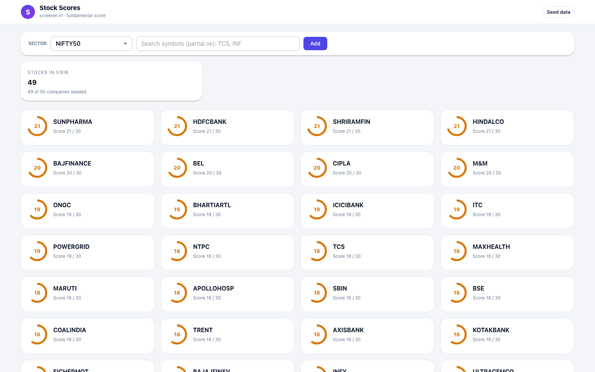
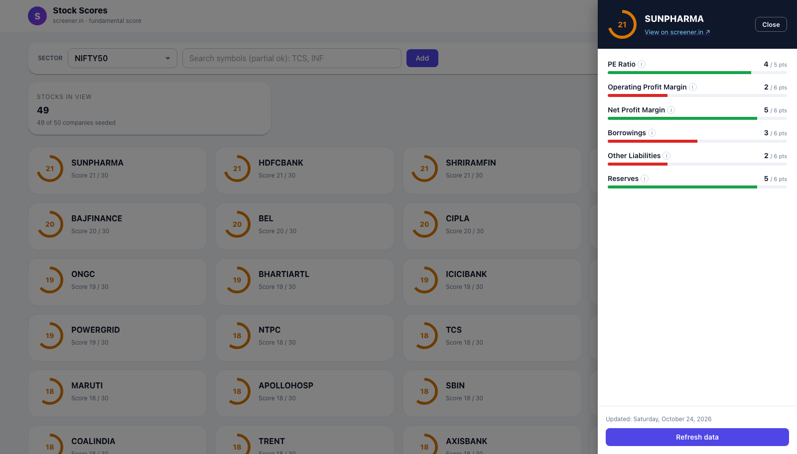

# Stock Scores

A fundamental-analysis dashboard for Indian stocks. It scores companies listed on screener.in by the quality of their financials — profitability, debt, and retained earnings — and ranks them so the healthiest companies in an index or sector float to the top.

## What It Does

Each company is evaluated on six financial metrics and given a score out of **30**, updated with data refreshed from screener.in:

| Metric | Max points | What it measures |
|:-------|:----------:|:-----------------|
| PE Ratio | 5 | Valuation — PE 1–20 earns the full 5 points; the score steps down in tiers as the ratio climbs |
| Operating Profit Margin | 6 | Profitability from core operations before interest and taxes — one point per improving year in the last 6 |
| Net Profit Margin | 6 | Profit left after all expenses — one point per improving year in the last 6 |
| Borrowings | 6 | Loan and debt burden — one point per falling year in the last 6 |
| Other Liabilities | 6 | Long-dated liabilities besides borrowings — one point per falling year in the last 6 |
| Reserves | 6 | Retained earnings kept out of dividends — one point per improving year in the last 6 |

Scores are colour-coded so quality is visible at a glance: green for 24+, amber for 16+, red below that.

## Dashboard

The main view lists every seeded company in the selected sector (e.g. NIFTY 50) ranked by score, with a score ring per company. Use the search box to add symbols that are not seeded yet.

Clicking a stock opens a breakdown of its score — each metric shown as a progress bar against its maximum, with a tooltip explaining how that metric is scored and a link to the full report on screener.in.

## How It Works

The application is composed of three services:

- **Scraper** — an Express app that fetches company financials from screener.in and exposes the parsed data.
- **Backend** — a Spring Boot service that pulls data from the scraper, computes the score breakdown per metric, and stores the results.
- **Frontend** — a React (Material UI) dashboard that renders the ranked list and per-stock score breakdowns.

## Related Docs

- `Common Definitions.md` — financial term definitions used by the scoring model
- `FactorsForChosingStock.md` — investing ideas and company-study notes behind the chosen factors
